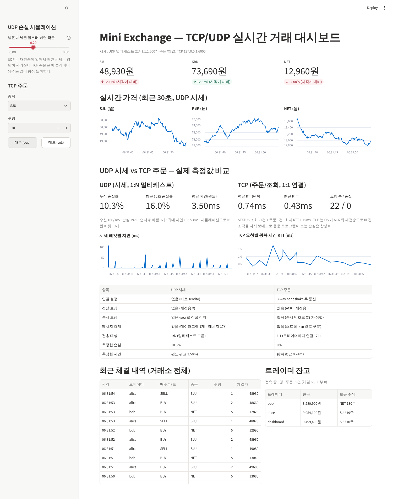

# Mini Exchange — A Real-Time Stock Trading Simulator over TCP/UDP

**English** | [한국어](README.ko.md)

A Computer Networks course project. Like a real stock exchange, this small exchange **broadcasts market data to every trader over UDP multicast**
and **exchanges orders and fills over TCP**. It is built using only Python's standard `socket` module.
The terminal and the dashboard show, in concrete numbers, how the two protocols behave differently in a real application.



## Architecture

```
                         ┌───────────────────────────────────┐
                         │         exchange_server.py        │
                         │                                   │
                         │  [Market-data thread] every 0.1 s │
                         │   prices change by random walk    │
                         │        │                          │
                         │        ▼ sendto (once)            │
                         │  UDP 224.1.1.1:5007 ──────────────┼──┐ Multicast (1:N)
                         │                                   │  │ loss-tolerant · low latency
                         │  [Main thread] accept()           │  │
                         │  TCP 127.0.0.1:6000               │  │
                         │   ├─ [Trader thread] alice      ◀─┼──┼──┐ TCP connections (1:1)
                         │   ├─ [Trader thread] bob        ◀─┼──┼──┤ reliable · in-order
                         │   └─ [Trader thread] dashboard  ◀─┼──┼──┤
                         └───────────────────────────────────┘  │  │
                                                                ▼  ▼
   trader_client.py (alice)        trader_client.py (bob)        dashboard.py
   UDP quotes in + TCP orders      UDP quotes in + TCP orders    visualizes UDP + TCP stats
```

| Channel | Address | Direction | Purpose | Why this protocol |
|---|---|---|---|---|
| UDP multicast | 224.1.1.1:5007 | Exchange → all traders | Market data (quotes) | A new quote arrives every 0.1 s. If one is lost, the next one comes shortly, so receiving quickly matters more than waiting for a retransmission. A single send reaches the whole group. |
| TCP | 127.0.0.1:6000 | Trader ↔ exchange | Orders / fills | If an order is lost or reordered, the money goes wrong. With TCP, the OS handles ACKs, retransmission, and reordering. |

## Files

| File | Contents |
|---|---|
| `protocol.py` | Shared settings (addresses, ports, symbols), JSON encoding/decoding, newline framing for TCP (`LineReader`) |
| `exchange_server.py` | Quote generation + UDP multicast sender + multithreaded TCP order server, account management |
| `trader_client.py` | UDP quote receiver (measures loss rate, latency, reordering) + TCP order sender (measures RTT) |
| `dashboard.py` | Streamlit dashboard: price charts, side-by-side UDP/TCP statistics, recent fills |
| `tests/test_message_boundary.py` | TCP message-boundary experiment (coalesced sends / sending one byte at a time) |
| `test_logs/` | Logs from actual test runs at each stage |
| `AI_LOG.md` | Record of the development process with AI (Claude) ([Korean](AI_LOG.ko.md)) |
| `CLAUDE.md` | Requirements and rules given to the AI ([Korean](CLAUDE.ko.md)) |

## How to Run

Python 3.10 or later. The server and traders use **only the standard library**, so nothing needs to be installed. Only the dashboard requires Streamlit.

```bash
pip install -r requirements.txt      # only needed for the dashboard
```

Open several terminals and run the following. (The command may be `python` on Windows and `python3` on Mac.)

```bash
# 1) Exchange server
python exchange_server.py

# 2) Traders (one per terminal, two or more)
python trader_client.py --name alice
python trader_client.py --name bob --drop 0.1        # deliberately drops 10% of received quotes

# 3) Dashboard (opens in the browser at http://localhost:8501)
streamlit run dashboard.py
```

### Trader Commands

```
buy SJU 10      Buy 10 shares of SJU → order sent over TCP → filled immediately at the current price → FILL reply + RTT shown
sell KBK 5      Sell 5 shares of KBK
balance         Show cash and holdings
price           Latest quotes + UDP statistics
stats           Compare UDP statistics with TCP RTT statistics
quit            Exit (prints final statistics)
```

Example output (the program's messages are in Korean; 주 = shares, 원 = KRW, 현금 = cash, 보유 = holdings, 수신 = received, 손실 = lost, 역순 = out of order, 지연 = latency, 평균/최소/최대 = avg/min/max, 체결 = filled, 거부 = rejected, 현금 부족 = insufficient cash):

```
[alice] FILL #1 BUY SJU 10주 @ 49,720원 (내가 본 시세 49,720) RTT 0.44ms | 현금 9,502,800원 | 보유 SJU 10주
[alice] REJECT #5 현금 부족 (필요 72,070,000원, 보유 9,341,630원) RTT 0.22ms
[bob] UDP 시세 : 수신 365/399  손실 34개(8.5%)  역순 0개  지연 평균 0.30ms / 최대 2.67ms
[bob] TCP 주문 : 주문 40건 (체결 40, 거부 0, 손실 0)  RTT 평균 0.67ms / 최소 0.10ms / 최대 4.28ms
```

### Trader Options

| Option | Description |
|---|---|
| `--name alice` | Trader name. Reconnecting with the same name resumes the same account. New accounts start with 10,000,000 KRW in cash. |
| `--drop 0.1` | Drops received quote packets with 10% probability (simulates network loss). Has no effect on TCP orders. |
| `--reorder 0.05` | **[Optional, for demonstration]** With 5% probability, holds one packet back and processes it after the next one. On a single machine packets are almost never reordered, so this option exists to demonstrate the out-of-order detection feature. |
| `--watch` | Watch mode. Prints quotes and UDP statistics once per second, without sending any TCP orders. |
| `--duration 10` | In `--watch` mode, exits automatically after 10 seconds (for testing). |
| `--iface 127.0.0.1` | Network interface used for multicast (see Troubleshooting below). |

### Demo Scenario

1. Start the server, `alice`, `bob --drop 0.2`, and the dashboard.
2. Enter `buy`/`sell` in both alice and bob → the server output shows fills from both traders interleaved (handled concurrently by threads).
3. Run `stats` in both → **bob's UDP loss rate is about 20%, yet not a single TCP order is lost.**
4. Raise the loss probability with the slider in the dashboard sidebar, and the "loss rate over the last 10 seconds" rises accordingly. TCP request loss still stays at 0.
5. Stop the server and place an order from a trader → TCP notices the broken connection immediately. In contrast, a UDP receiver just waits silently even when the server is down (because UDP has no notion of a connection).
6. Run `python tests/test_message_boundary.py` → confirm that the server splits messages correctly, whether two orders are sent coalesced in one write or a single order is sent one byte at a time.

## How TCP and UDP Behave Differently in This Program

| | UDP quotes | TCP orders |
|---|---|---|
| Connection | None. Data is sent directly with `sendto`. No error occurs even if nobody is listening. | `connect` performs the 3-way handshake (SYN → SYN+ACK → ACK). If the server is down, `ConnectionRefusedError` is raised immediately. |
| Delivery guarantee | None. A lost packet is gone for good, and the server never knows. | The OS retransmits until it receives an ACK. The loss seen by the application is 0. |
| Ordering | Not guaranteed → we attach a `seq` number: a missing number means loss, and a smaller number arriving late means reordering. | The OS reorders segments using TCP sequence numbers and delivers data in the order it was sent. |
| Message boundaries | Preserved. One `sendto` = one `recvfrom` = one message. | None (byte stream). Messages may be merged or split in transit → we append `\n` to each message, and `LineReader` buffers data until `\n` and splits there. |
| Recipients | 1:N. One send to the multicast group (joined via IGMP) reaches every member. | 1:1. One connection (socket) and one server thread per trader. |
| Latency measured | One-way latency = receive time − `ts` stamped by the server. (Accurate only when both share the same clock, i.e. the same machine.) | RTT = from sending the order to receiving the FILL. Measured with a single local clock, so it is accurate even if the server's clock differs. |

### How Multicast Works (Summary)
- Addresses 224.0.0.0 – 239.255.255.255 refer not to a specific host but to a **group**.
- When a receiver calls `IP_ADD_MEMBERSHIP`, the OS sends an **IGMP Membership Report** announcing "I want to receive packets for this group". Without joining, merely binding the socket does not deliver any packets.
- The sender sets `IP_MULTICAST_TTL=1` so that packets do not leave the LAN, and `IP_MULTICAST_LOOP=1` so that receivers on the same machine also get them.

## Windows / Mac Compatibility

- The receiving socket binds to `""` (all addresses) rather than to the multicast address, because Windows cannot bind to a multicast address.
- To let several traders on one machine share port 5007, `SO_REUSEADDR` is enabled, and `SO_REUSEPORT` is enabled too where available (required on Mac, absent on Windows).
- `accept`/`recvfrom` use a 1-second timeout so that Ctrl+C also terminates the program on Windows.

## Troubleshooting

- **A trader receives no quotes at all (especially on Mac, with Wi-Fi off or a VPN on)**: run both the server and the traders with `--iface 127.0.0.1`.
  To change it for the dashboard as well in one place, set `MCAST_IFACE = "127.0.0.1"` in `protocol.py`.
- **A Windows Firewall prompt appears**: allow access on "Private networks". If it is blocked, multicast packets will not arrive.
- **`Address already in use`**: check whether a previous server is still running. (The TCP server enables `SO_REUSEADDR`, so it can be restarted right away.)
- **Occasional 50–100 ms spikes in the dashboard's UDP latency chart**: this is not a network problem. It is a processing delay caused by Python's GIL briefly pausing the receiver thread while Streamlit renders the page. Over the same period, the terminal traders' latency stays stable at around 0.3 ms on average.

## Test Results Summary (single machine, 1 server + multiple clients)

| Stage | Setup | Result |
|---|---|---|
| 1. UDP quotes | Server + 3 clients (default / `--drop 0.1` / `--reorder 0.05`), 10 s | Default: 0% loss, 0.34 ms latency · drop: 15% loss · reorder: 3 out-of-order packets detected |
| 2. TCP orders | Server + 3 trading clients + 1 watcher + boundary experiment | 70+ concurrent orders all filled, carol's 60 back-to-back orders averaged 0.09 ms RTT, insufficient cash/holdings correctly rejected, both coalesced and split sends handled correctly |
| 3. Dashboard | Server + 2 traders + dashboard (slider at 0.2) | UDP loss rate shown at 10–16%, 22 TCP requests with 0 lost, 0.74 ms average RTT, full fill history displayed |

See `test_logs/` for detailed logs and `AI_LOG.md` for the development process.
